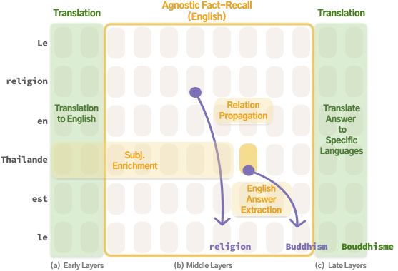

# Paths Not Taken: Understanding & Mending the Multilingual Factual-Recall Pipeline

This repository hosts the **official implementation** for our paper:

> **Paths Not Taken: Understanding and Mending the Multilingual Factual-Recall Pipeline**  
> Meng Lu\*, Ruochen Zhang\*, Carsten Eickhoff, Ellie Pavlick — 2025  
> (\*equal contribution)

---

---

## Overview

The codebase allows you to 

- **Reproduce** all key experiments from Sections 2 – 3 of the paper  
- **Evaluate** multilingual factual-recall performance under targeted vector interventions at specific transformer layers to repair multilingual inconsistencies  

---

##  Contents

| Path | Purpose |
|------|---------|
| `demo_intervention_performance.py` | Evaluate multilingual datasets and quantify the effect of each intervention |
| `demo_replicate_experiments.ipynb` | Walk-through notebook that reproduces the analyses and figures in Sections 2 & 3 |

---

## 🛠️ Running the Intervention Experiments

To test performance with **both** the translation **difference vector** *and* the recall **task vector**:

```bash
python demo_intervention_performance.py \
  --model llama-3b \
  --diff_layer 25 \
  --task_layer 3 \
  --task_scale 2 \
  --split_strategy within_dataset \
  --seed 15 \
  --condition diff_task
```

| Flag               | Description                                                                                                                                                                          |
| ------------------ | ------------------------------------------------------------------------------------------------------------------------------------------------------------------------------------ |
| `--model`          | Pre-trained model to load.<br>**Options:** `llama-1b`, `llama-3b`, `llama-7b`, `llama-8b`, `llama-3b_instruct`, `Qwen2_0.5B`, `Qwen2_1.5b`, `Qwen2.5-3B`  •  **Default:** `llama-3b` |
| `--diff_layer`     | Transformer layer that receives the **translation difference vector** (Section 3.2).<br>**Int** • Default `25`                                                                       |
| `--task_layer`     | Layer that receives the **recall task vector** (Section 4.2).<br>**Int** • Default `3`                                                                                               |
| `--task_scale`     | Multiplicative scale applied to the task vector (controls intervention strength).<br>**Int** • Default `2`                                                                           |
| `--split_strategy` | Dataset split method:<br>`within_dataset` (independent splits per relation) or `across_dataset` (train on a subset of relations, test on unseen).<br>**Default:** `within_dataset`   |
| `--seed`           | Random seed guaranteeing reproducible splits.                                                                                                                                        |
| `--condition`      | Intervention configuration:<br>`orig` (no intervention) • `diff` (difference vector only) • `task` (task vector only) • `diff_task` (both).<br>**Default:** `diff_task`              |

Feel free to open an issue or reach out to meng_lu@brown.edu.

---

## Local private copy and authentication

This copy imports the current files from [mlu108/paths_not_taken](https://github.com/mlu108/paths_not_taken) at commit `0318194d41e8175c134a7fd83394b328bec11544`. Original paper authorship and attribution are retained above. The private publication starts with a clean root commit rather than importing upstream Git history.

For gated Hugging Face models, set `HF_TOKEN` in your local environment or authenticate with the Hugging Face CLI beforehand. The loader uses `HF_TOKEN` when provided and otherwise relies on cached authentication. Credentials are not stored in source files or added to Git credentials. Local indexes, caches, environment files, downloaded models, and generated tensors are excluded by `.gitignore`.
